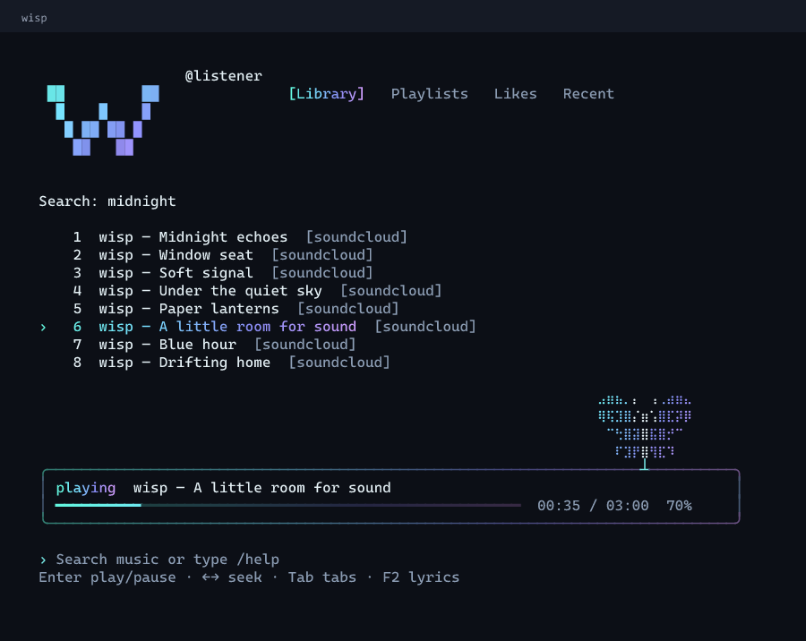
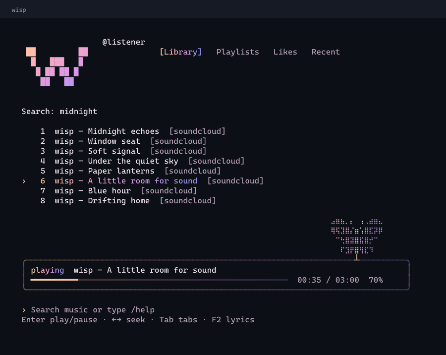
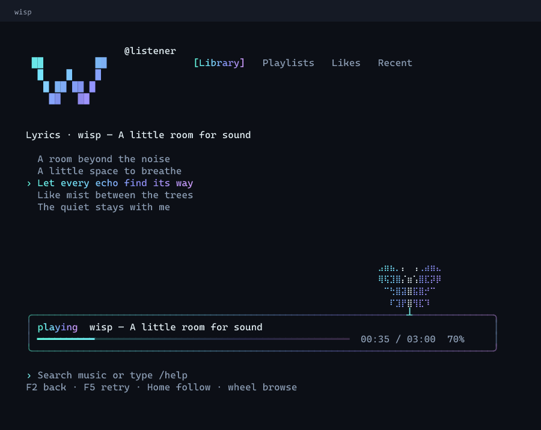
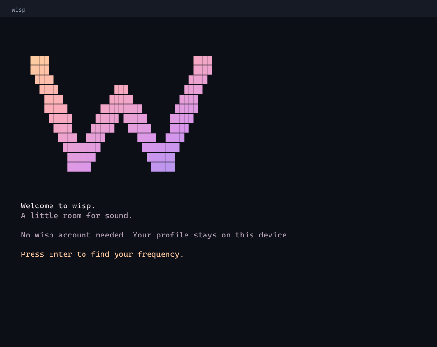
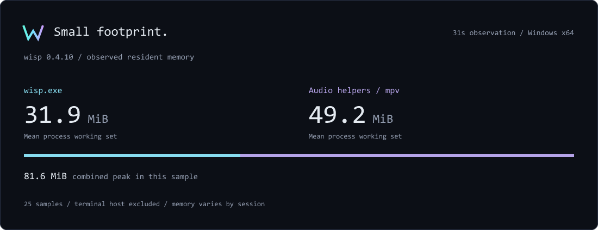

<div align="center">

[English](README.md) · **Русский**


### Твоя музыка. Спокойный интерфейс.

Терминальный музыкальный плеер для Windows: постоянная строка ввода,
мягкие градиенты и маленькая бабочка, которая летает рядом с музыкой.

[](https://github.com/cmuty/wisp/releases/latest)
[](#быстрый-старт)
[](LICENSE)
[](https://discord.gg/wJaJHK2hFA)

[Установка](#быстрый-старт) · [Showcase](#showcase) · [Расход памяти](#расход-памяти) · [Как это работает](#как-это-работает) · [Документация](docs/README.md) · [Discord](https://discord.gg/wJaJHK2hFA)

</div>

## Быстрый старт

Выполни в **PowerShell** на 64-битной Windows:

```powershell
irm https://github.com/cmuty/wisp/releases/latest/download/install.ps1 | iex
```

После установки запускай из любой папки в PowerShell или командной строке:

```text
wisp
```

Установщик проверяет SHA-256 архива, скачивает аудиокомпоненты и добавляет
`wisp` в пользовательский PATH. Права администратора не нужны. Уже открытый
CMD может потребовать перезапуска, чтобы увидеть обновлённый PATH.

При первом запуске выбери **русский или английский**, введи имя, настрой тему
и источники поиска. Профиль wisp хранится локально, отдельная регистрация не нужна.
Ручная установка и просмотр скрипта перед запуском — в [инструкции](docs/INSTALLATION.md).

**EXE:** скачай [установщик Windows](https://github.com/cmuty/wisp/releases/latest/download/wisp-setup-x64.exe)
и открой его. Есть мастер установки, пункт в меню «Пуск» и удаление через
«Установленные приложения». Для настройки аудиокомпонентов нужен интернет.

**Scoop:** если Scoop и Git уже установлены, подключи наш bucket:

```powershell
scoop bucket add extras
scoop bucket add wisp https://github.com/cmuty/wisp
scoop install wisp/wisp
```

**WinGet:** [заявка №457542](https://github.com/microsoft/winget-pkgs/pull/457542)
для `cmuty.wisp` отправлена. Установка по имени из общего каталога станет доступна
после одобрения и индексации пакета. Статус — в [руководстве](docs/PACKAGING.md).

## Showcase



<details><summary>Afterglow, текст песни и первый запуск</summary>







</details>

Изображения получены из собственного `--preview` режима приложения: настоящая
разметка интерфейса с демонстрационными треками и придуманным текстом песни.
Внешний вид зависит от шрифта и поддержки цветов в терминале.

## Возможности

- **Одна строка ввода.** Пиши запрос, вставляй ссылку на плейлист или вводи команду. Подсказки появляются сразу, Tab дополняет команду.
- **Медиатека, плейлисты, любимое и недавние.** Запуск трека ставит следующие результаты в очередь; музыка продолжается автоматически.
- **Клавиатура и мышь.** Колесо прокручивает список, Enter ставит на паузу, стрелки перематывают, `+` и `-` меняют громкость.
- **Синхронная лирика.** Подсветка текущей строки, ручная прокрутка, поправка тайминга и локальные файлы `.lrc`.
- **Пять тем.** Дымка, Уголёк, Туман, Сияние и Послесвечение. Градиентный логотип, аккуратные акценты и анимированная бабочка, которую можно выключить в `/settings`. Есть ASCII и режим уменьшенного движения.
- **Два языка.** Русский и английский доступны при первом запуске и через `/language`.

## Расход памяти



**Около 32 МиБ для самого wisp** в замеренной сессии на Windows x64.
За 31 секунду интерфейс в среднем занимал **31,9 МиБ**, отдельный аудиопроцесс
mpv — **49,2 МиБ**. Суммарный пик их рабочих наборов составил **81,6 МиБ**.

Карточка построена по записанным счётчикам процессов. Это результат конкретной
сессии, а не верхняя граница расхода памяти. Терминал и временные процессы вне
окна замера не учтены. [Методика, исходные данные и повторение замера](docs/MEMORY.md).

## Как это работает

**Найти → добавить в очередь → слушать.** Поиск объединяет включённые источники
и локальную библиотеку. Импорт сохраняет порядок, метаданные и ссылки на треки.
Перед воспроизведением wisp получает доступный поток и передаёт его **mpv** через
JSON IPC. Коллекция скачанных аудиозаписей не создаётся.

| Источник | Поддержка |
| --- | --- |
| SoundCloud | Публичный поиск, импорт плейлистов и доступные публичные аудиопотоки. |
| YouTube Music | Публичный поиск, плейлисты и получение аудиопотока через yt-dlp. |
| Spotify | Импорт метаданных публичного плейлиста и подбор записи на другом источнике. Прямого стриминга Spotify нет. |
| Локальные файлы | Файлы и папки, локальные M3U/M3U8, CSV с метаданными. |

Публичные web-адаптеры могут работать без персонального API-токена. Доступность
зависит от сервиса, региона и конкретной записи. Импорт Spotify ограничен
метаданными, которые отдаёт его embed-страница; для больших коллекций есть CSV.
Приватный контент, DRM и ограничения доступа не обходятся.
Подробнее — [источники и ограничения](docs/SOURCES.md).

Ядро написано на **Go**, интерфейс — **Bubble Tea / Bubbles / Lip Gloss**.
PowerShell отвечает за установку, mpv — за звук, yt-dlp — за YouTube,
LRCLIB и локальные LRC — за текст песни.

## Управление

| Ввод | Действие |
| --- | --- |
| Текст или `/search запрос` | Поиск по включённым источникам |
| Tab / Shift+Tab | Переключить раздел; дополнить активную подсказку команды |
| ↑ / ↓ или колесо | Выбрать трек |
| Enter | Воспроизвести; повторно на текущем треке — пауза / продолжить |
| Shift+Enter | Лайк; если терминал не передаёт сочетание — `/like` |
| ← / → | Перемотать на 5 секунд; с Shift — на 1 секунду |
| `-` / `+` | Громкость ±5; с Shift — ±1 |
| F2 или `/lyrics` | Открыть / закрыть текст песни |
| `/settings` | Тема и источники поиска |
| `/language ru` | Русский интерфейс |
| `/help` | Все команды |

Перемотка и громкость с клавиатуры работают при пустой строке ввода.
Некоторые сочетания зависят от терминала; есть команды-аналоги.
Примеры плейлистов и полная справка — в [документации команд](docs/COMMANDS.md).

## Документация

Подробные руководства пока на английском:
[установка](docs/INSTALLATION.md), [команды](docs/COMMANDS.md),
[источники](docs/SOURCES.md), [подключения](docs/CONNECTIONS.md),
[решение проблем](docs/TROUBLESHOOTING.md), [разработка](docs/DEVELOPMENT.md),
[дизайн](docs/DESIGN.md).

## Сообщество

<div align="center"><table><tr><td align="center">
<br><strong>Немного места, чтобы делать wisp вместе.</strong><br><br>
Покажи свой сетап, предложи идею или задай вопрос о плеере.<br><br>
<a href="https://discord.gg/wJaJHK2hFA"><strong>Присоединиться к Discord wisp</strong></a><br><br>
</td></tr></table></div>

Баги и небольшие pull request приветствуются. Перед отправкой ознакомься с
[правилами участия](CONTRIBUTING.md) и [Security](SECURITY.md).

## Лицензия

Код wisp — [MIT](LICENSE). У зависимостей и внешних аудиокомпонентов собственные
лицензии: [Third-party notices](THIRD_PARTY.md). Проект независимый и не связан
с музыкальными платформами.
